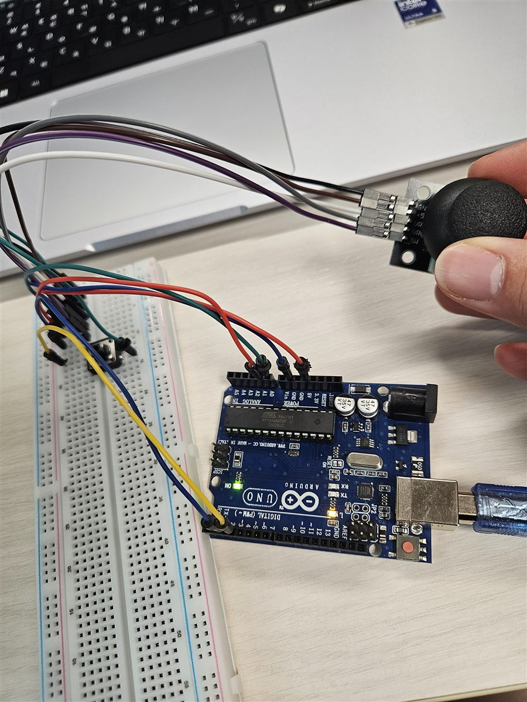
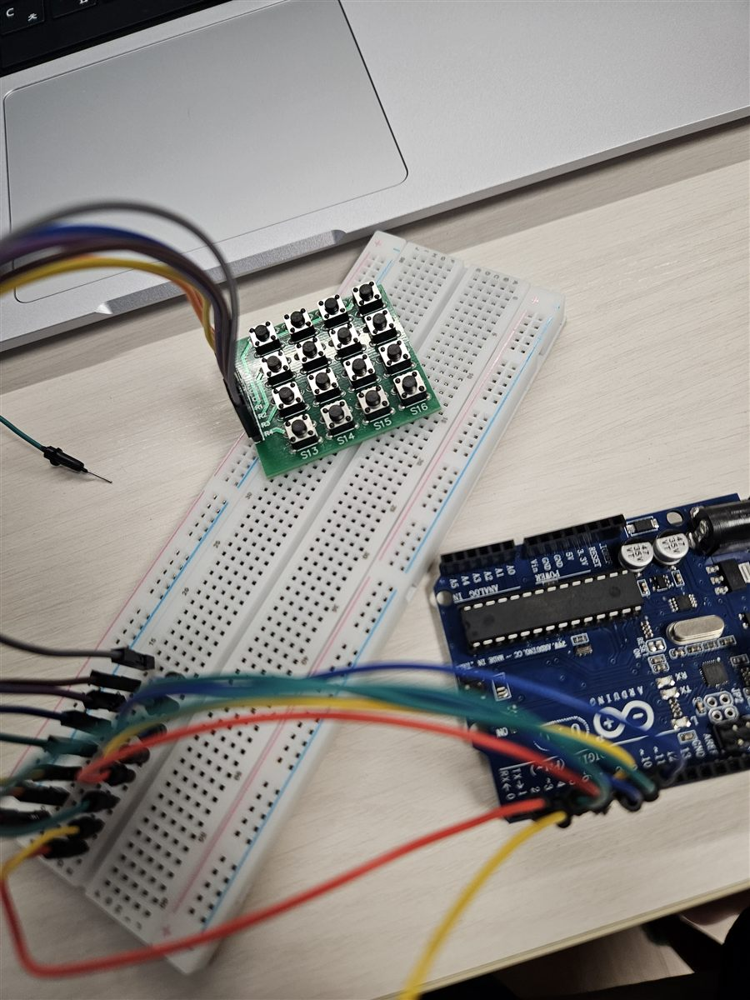
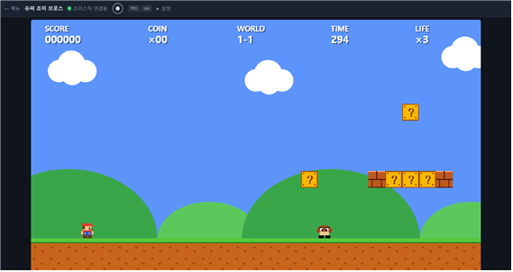
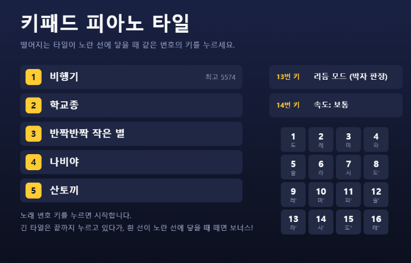

# 아두이노 우노 실습 (VS Code)

VS Code에서 **arduino-cli + PlatformIO**로 Arduino Uno를 다룬 실습 모음입니다.
LED·LCD·센서 같은 기본 부품부터, 조이스틱과 키패드를 **Web Serial**로 브라우저에 연결한 웹 게임까지 단계별로 진행했습니다.

<p>
  
  
</p>

## 실습 목록

| # | 실습 | 사용 부품 | 핵심 내용 |
|---|------|-----------|-----------|
| 00 | [check](labs/00_check) | 보드 내장 LED | 개발 환경·업로드·시리얼 통신 확인 |
| 01 | [rgb_blink](labs/01_rgb_blink) | RGB LED (공통 −), 1kΩ ×3 | PWM으로 빛 섞기 |
| 02 | [LCD_Helloworld](labs/02_LCD_Helloworld) | LCD1602 + I2C 백팩 | I2C LCD에 글자 출력 |
| 03 | [weather](labs/03_weather) | LCD1602, DHT11 | 온습도 + 날짜·시간(KST), 화면 슬라이드 전환 |
| 04 | [joystick](labs/04_joystick) | 조이스틱, 택트 스위치 | 웹 게임 2종 (플랫포머, 비행 슈팅) |
| 05 | [44button](labs/05_44button) | 4×4 키패드 | 누른 키 번호(1~16) 출력 |
| 06 | [piano](labs/06_piano) | 4×4 키패드, 수동 피에조 부저 | 16음 키패드 피아노 + 동요 악보 |
| 07 | [piano_tiles](labs/07_piano_tiles) | 4×4 키패드, 수동 피에조 부저 | 웹 리듬게임 (피아노 타일) |
| 08 | [remotecontrol](labs/08_remotecontrol) | IR 수신기, 21키 리모컨 | 리모컨 버튼 해독 |
| 09 | [sound](labs/09_sound) | 소리 감지 모듈 | 추정 dB 측정 + ANSI 색 경보 |

## 개발 환경

- 보드: Arduino Uno (`arduino:avr:uno`), Windows에서 `COM5`
- 도구: [arduino-cli](https://arduino.github.io/arduino-cli/), [PlatformIO](https://platformio.org/) (VS Code 확장), Python 3
- 라이브러리 (arduino-cli로 설치, PlatformIO는 `lib_extra_dirs`로 공유)
  - `hd44780` — I2C LCD (주소 자동 탐색)
  - `DHT sensor library`, `Adafruit Unified Sensor` — DHT11
  - `Keypad` — 4×4 키패드
  - `IRremote` — IR 리모컨

```
arduino-cli lib install hd44780 "DHT sensor library" "Adafruit Unified Sensor" Keypad IRremote
```

## 폴더 구조

```
labs/NN_이름/NN_이름.ino   실습마다 스케치 하나 (폴더 이름 = 파일 이름)
labs/04_joystick/web/      조이스틱 웹 게임
labs/07_piano_tiles/web/   피아노 타일 웹 게임
tools/lab.py               새 실습 만들기·컴파일·업로드·모니터 도우미
docs/progress.md           실습 진행 기록
docs/images/               사진·스크린샷
platformio.ini             PlatformIO 설정 (src_dir 은 lab.py 가 실습별로 지정)
```

## 사용법

```
python tools/lab.py new 10_이름           # 새 실습 폴더와 스케치 만들기
python tools/lab.py compile 03_weather    # 컴파일 (기본 PlatformIO, --cli 를 붙이면 arduino-cli)
python tools/lab.py upload 03_weather     # 컴파일 + 업로드
python tools/lab.py monitor               # 시리얼 모니터 (9600bps, ANSI 색 그대로 표시)
python tools/lab.py done 03_weather "메모" # docs/progress.md 에 완료 기록
```

> VS Code 아래쪽 PlatformIO **Upload** 버튼은 `platformio.ini`의 `src_dir`에 적힌 실습만 올립니다.
> 다른 실습을 버튼으로 올리려면 `src_dir = labs/NN_이름` 으로 바꾸거나 `lab.py upload` 를 쓰세요.

---

## 00 · 개발 환경 확인

보드 내장 LED(D13)를 1초 간격으로 깜빡이고 시리얼로 `LED ON / LED OFF`를 출력합니다.
`arduino-cli board list`로 보드 인식 → 업로드 → 시리얼 수신까지 한 번에 확인하는 용도입니다.

## 01 · RGB LED 빛 섞기

| UNO | 연결 |
|-----|------|
| D9 | 1kΩ → R |
| D10 | 1kΩ → G |
| D11 | 1kΩ → B |
| GND | 공통 − |

PWM(`analogWrite`)으로 빨강 → 초록 → 파랑 → 보라를 0.8초씩 반복합니다.
공통 +(애노드)형 모듈이면 `COMMON_ANODE = true`로 바꾸고 공통 핀을 5V에 연결합니다.

## 02 · LCD1602 Hello World

| UNO | LCD I2C 백팩 |
|-----|--------------|
| GND | GND |
| 5V | VCC |
| A4 | SDA |
| A5 | SCL |

`hd44780` 라이브러리의 `hd44780_I2Cexp`가 백팩 주소(이 모듈은 `0x27`)와 핀 배치를 자동으로 찾습니다.

- 백라이트만 켜지고 글자가 안 보이면 **백팩 뒷면의 파란 가변저항(명암)**을 돌립니다.

## 03 · 온습도 + 날짜·시간 표시

02의 LCD 배선에 DHT11 `DATA → D2`를 추가했습니다.

```
   2026-10-26            Temp 27.1°C
    14:41:21      ◀      Humi 46%
 (5초, 매초 갱신)          (5초)
```

- 날짜·시간 화면과 온습도 화면이 5초씩 번갈아 나오고, 전환할 때 한 칸씩 **왼쪽으로 밀려나는 슬라이드**가 있습니다.
- RTC 모듈이 없어서 시작 시각은 **컴파일 시각(PC 시간 = KST)**이고, 시리얼로 `T2026-10-26 14:30:00`을 보내면 맞춰집니다.
- **I2C 버스 멈춤 해결**: LCD와 통신하는 도중 보드가 리셋되면 LCD가 SDA를 LOW로 붙잡아 `lcd.begin()`이 멈췄습니다. `setup()`에서 SCL을 최대 9번 흔들어 버스를 풀어 주는 `releaseI2C()`를 넣어 해결했습니다.

## 04 · 조이스틱 웹 게임

| UNO | 연결 |
|-----|------|
| GND / 5V | 조이스틱 GND / +5V |
| A0 / A1 | VRx / VRy |
| D2 | 조이스틱 SW (누르기) |
| D3 | 택트 스위치 (다른 쪽은 GND, 내부 풀업) |

펌웨어는 약 60Hz로 `x,y,sw,btn` 한 줄을 **115200bps**로 보냅니다.
브라우저(Chrome·Edge)의 **Web Serial API**가 COM 포트를 직접 읽기 때문에 별도 중계 프로그램이 필요 없습니다.



| | 슈퍼 조이 브로스 (플랫포머) | 조이 스트라이커 1945 (비행 슈팅) |
|---|---|---|
| 스틱 | 좌우 이동(기울기만큼 속도), 아래 = 웅크리기 | 8방향 이동 |
| 택트 스위치 | 점프 (길게 누르면 높이) | 공격 (누르고 있으면 연사) |
| 스틱 누르기(SW) | 일시정지 | 폭탄 |

- 플랫포머: 블록·동전·버섯(커지기)·적 밟기·파이프·계단·깃발, 중간 체크포인트
- 슈팅: 적 편대 5종, 중형기, 파워업(P)·폭탄(B), 60초 뒤 보스, 스테이지마다 난이도 상승
- 연결 직후 스틱 중앙값을 자동 보정하고, 설정에서 좌우·상하 반전과 X·Y 바꾸기를 할 수 있습니다.
- 조이스틱 없이 키보드(방향키, Z, X)로도 플레이할 수 있습니다.

```
python -m http.server 8765 --directory labs/04_joystick/web
# Chrome 에서 http://127.0.0.1:8765 → [조이스틱 연결] → COM 포트 선택
```

## 05 · 4×4 키패드

키패드 8핀을 `D2~D9`에 순서대로 연결했습니다.
처음에는 1~4번 핀을 행으로 가정했는데, 실제로 눌러 보니 출력이 90° 돌아가 있었습니다(첫 줄이 `13 9 5 1`).
그래서 **D6~D9 = 행(위→아래), D5~D2 = 열(왼쪽→오른쪽)**로 고쳤고, 16개 키가 `1 … 16` 순서로 나오는 것을 확인했습니다.

```
키 1 (1)   키 2 (2)   키 3 (3)   키 4 (A)
...
키 13 (*)  키 14 (0)  키 15 (#)  키 16 (D)
```

## 06 · 키패드 피아노

05의 키패드에 수동 피에조 부저(`+ → D10`, `− → GND`)를 추가했습니다. 키를 **누르고 있는 동안** 그 음이 계속 납니다.

```
[ 1 도  ] [ 2 레  ] [ 3 미  ] [ 4 파  ]
[ 5 솔  ] [ 6 라  ] [ 7 시  ] [ 8 도' ]
[ 9 레' ] [10 미' ] [11 파' ] [12 솔' ]
[13 라' ] [14 시' ] [15 도''] [16 레'']
```

- 도(C4, 262Hz)부터 레(D6, 1175Hz)까지 다장조 두 옥타브 남짓
- 두 키를 같이 누르면 나중에 누른 음, 그 키를 떼면 아직 누르고 있는 음으로 돌아갑니다.
- 비행기·학교종·반짝반짝 작은 별·나비야·산토끼 악보(키 번호): [songs.md](labs/06_piano/songs.md)

## 07 · 피아노 타일 리듬게임

06과 같은 배선입니다. 펌웨어는 부저로 소리를 내면서 키 이벤트를 `P5`(누름) / `R5`(뗌)로 보냅니다.
입력 지연을 줄이려고 키패드 디바운스를 5ms로 낮췄습니다.



- 키 1~8 레인에 떨어지는 타일이 노란 판정선에 닿을 때 같은 번호의 키를 누릅니다.
- **리듬 모드**: ±0.07초 PERFECT · ±0.14초 GOOD · ±0.2초 BAD, 놓치면 MISS → 점수·콤보·S~D 등급
- **연습 모드**: 맞는 키를 누를 때까지 노래가 기다립니다 (원래 피아노 타일 방식).
- **긴 타일(2박 이상)**: 끝까지 누르고 있다가 흰 선이 판정선에 닿을 때 떼면 보너스(±0.1초 PERFECT, ±0.2초 GOOD). 일찍 떼면 EARLY(콤보 끊김), 너무 오래 누르면 LATE.
- 메뉴: 1~5번 키 = 노래 선택, 13번 = 모드, 14번 = 속도, 16번 = 메뉴로
- 노래·모드·속도별 최고 기록 저장, 키보드(`1234 / QWER / ASDF / ZXCV`)로도 플레이 가능

```
python -m http.server 8766 --directory labs/07_piano_tiles/web
# Chrome 에서 http://127.0.0.1:8766 → [키패드 연결] → COM 포트 선택
```

## 08 · IR 리모컨

| UNO | IR 수신기 |
|-----|-----------|
| D2 | OUT |
| GND | GND |
| 5V | Vs |

`IRremote` 라이브러리로 신호를 해독해 버튼 이름·프로토콜·주소·명령 코드를 출력합니다. 길게 누르면 `(반복)`이 붙습니다.

```
버튼: CH- / POWER  | NEC 주소 0x00 명령 0x45
버튼: |<< 이전     | NEC 주소 0x00 명령 0x44
버튼: >|| 재생     | NEC 주소 0x00 명령 0x43
```

키트용 21키 리모컨(NEC, 주소 `0x00`)의 명령 코드표가 코드에 들어 있습니다.

## 09 · 소리 크기(dB) 측정

| UNO | 소리 감지 모듈 |
|-----|----------------|
| 5V | VCC (+) |
| GND | GND (−) |
| A0 | AO |

```
소리  48.1 dB [█████████··········|··········] 임계 70 dB  p2p 8
 ! 경보   73.4 dB — 임계값 70 dB 초과
   해제: 다시 조용해졌습니다 (경보 중 최대 81.2 dB)
```

- 0.25초 동안 AO 전압의 흔들림 폭(최대 − 최소)을 재서 `dB = 30 + 20·log10(폭)`으로 바꿉니다. 표현 범위는 **30 ~ 90 dB**입니다.
- 교정된 소음계가 아니므로 **추정값**입니다. 조용한 방에서 약 47~50 dB가 나왔습니다.
- 임계값(기본 70 dB)을 넘으면 빨간 경보 줄을 남기고, 1초 이상 조용해지면 해제 메시지를 남깁니다. `T65`처럼 보내면 임계값을 바꿀 수 있습니다.
- 초록·노랑·빨강 **ANSI 색**을 쓰므로 `lab.py monitor`(PlatformIO `-f direct` 필터)로 봐야 색이 보입니다.

---

## 실습하며 배운 것

| 증상 | 원인 | 해결 |
|------|------|------|
| 코드를 고쳤는데 PlatformIO Upload 후 동작이 그대로 | Upload 버튼은 `src_dir`의 실습만 올림 | `src_dir` 변경 또는 `lab.py upload` 사용 |
| `arduino-cli compile` 실패 | 폴더 이름과 `.ino` 이름이 다름 | `NN_이름/NN_이름.ino` 규칙 유지 |
| LCD 백라이트만 켜지고 글자 없음 | 명암 가변저항 | 백팩 뒷면 가변저항 조절 |
| 업로드 후 LCD 초기화에서 멈춤 | 통신 중 리셋으로 I2C 버스(SDA)가 LOW에 묶임 | SCL을 9번 토글해 버스 해제 |
| 키패드 번호가 뒤섞여 나옴 | 모듈의 행·열 핀 순서가 예상과 다름 | 순서대로 눌러 보고 핀 배열 수정 |
| 업로드 시 `cannot open port COM5` | USB가 빠졌거나 웹 게임 탭·시리얼 모니터가 포트를 잡고 있음 | 케이블 확인, 포트를 쓰는 탭·모니터 닫기 |
| 시리얼 모니터에 `[92m` 같은 글자 | 모니터가 ANSI 색 코드를 해석하지 못함 | VS Code 터미널 + PlatformIO `direct` 필터 |

진행 기록은 [docs/progress.md](docs/progress.md)에 있습니다.
